# Diagnosing the VQE Prototype: One Symmetry, Three Uses

**IQ Hackathon for Beginners 2026 · VQE track**

| | |
|---|---|
| **Group name** | _TODO_ |
| **Member** | Shahesta _TODO last name_ |
| **Affiliation** | _TODO university / organization_ |
| **Department** | _TODO_ |
| **Career level** | _TODO (e.g. undergraduate, graduate, professional)_ |
| **Submission category** | Rising Star |
| **Code** | [`notebooks/vqe_study.ipynb`](notebooks/vqe_study.ipynb) ([open in Colab](https://colab.research.google.com/github/S2800-0/iq-hackathon-vqe/blob/main/notebooks/vqe_study.ipynb)) |

---

## 1. Summary of what I did

- Reproduced the training notebook's H₂ VQE (1-parameter circuit, COBYLA) at 0.735 Å: −1.857275 Ha, matching the exact answer.
- Stretched H₂ from 0.5 to 2.5 Å and **explained with symmetry why the 1-parameter circuit stays exact everywhere** (error < 10⁻⁶ mHa).
- Used the same symmetry argument to **predict a molecule where the circuit falls short (HeH⁺)**, then confirmed it: 0.16 mHa error, against 10⁻⁶ mHa for a general circuit.
- Compared five optimizers, gradient-based and gradient-free, without noise and with noise.
- Cut optimizer evaluations by **about 21–23%** by warm-starting each bond length from the previous one.
- Simulated a real IBM chip's noise: errors grow to **55 mHa**, and readout-error mitigation brings them back to **5.9 mHa**. An error budget shows **readout causes ~86%** of the raw error.
- Tried **symmetry verification**, a published error filter that follows from the same symmetry, and showed it is **invalid for HeH⁺**: it gives an energy below the true minimum, which the variational principle forbids.
- Ran on **real IBM quantum hardware** (Open plan): **7.0 mHa** on ibm_marrakesh at 0.735 Å, plus full 8-point dissociation curves. Found that **qubit choice matters**: on ibm_kingston, qubits [0, 1] gave raw errors up to 486 mHa. After fixing the code to pick qubits by calibration, the same chip gave **1.8–20.6 mHa**.
- Built it as a tested Python package (`vqe_lab`, 70+ tests), developed in small reviewed pull requests, and ran the notebook top to bottom in Colab.

## 2. Motivation

I chose the VQE track because finding a molecule's lowest energy is a clear, physical problem, and the training notebook gave a working starting point I could test hard. The prototype checks one molecule at one bond length with no noise. I wanted to know: **where does it stop being right, and why?** Three questions drove the project:

1. Does the hand-built 1-parameter circuit still work when the bond is stretched? If yes, *why*?
2. What happens on a noisy device, and which part of the error can be fixed?
3. Can understanding the physics (rather than just running bigger circuits) predict when the method will fail?

## 3. Workflow

```
install cell (%pip) ─► build Hamiltonian ─► exact reference ─► VQE loop ─► sweep bond lengths
                       (PySCF, STO-3G,      (diagonalize)      (circuit +    │
                        parity → 2 qubits)                      estimator +   ├─► optimizers, warm start
                                                                optimizer)    ├─► noisy simulator + mitigation
                                                                              ├─► symmetry analysis (H₂ vs HeH⁺)
                                                                              └─► real IBM hardware (Sampler, one job)
```

- **`vqe_lab/hamiltonians.py`** builds molecules with PySCF and maps them to 2 qubits (parity mapping). Computes exact energies and ground-state weights.
- **`vqe_lab/vqe.py`** contains the prototype circuit, a general `efficient_su2` circuit, the VQE loop (SciPy optimizers plus a hand-written SPSA) and warm-started scans.
- **`vqe_lab/noise.py`** estimates energy from real shots on an ideal or noisy simulator (`FakeManilaV2` calibration), with readout mitigation and an optional symmetry filter.
- **`vqe_lab/symmetry.py`** finds forbidden basis states and computes a shot-free filtered energy.
- **`vqe_lab/hardware.py`** batches a whole dissociation curve into one IBM Sampler job, picks the best qubit pair from live calibration, and analyzes raw counts.
- **`notebooks/vqe_study.ipynb`** is the submission notebook. The first cell installs everything, and it runs in Colab. The real-hardware cells skip cleanly without an IBM key, and the author's runs are recorded in it.

Energies are electronic (nuclear repulsion excluded) unless a plot says "total energy". Errors are measured against exact diagonalization. **Chemical accuracy** = 1.6 mHa.

## 4. Results

### 4.1 Baseline and the dissociation curve

The prototype reproduces −1.857275 Ha at 0.735 Å in 23 evaluations. Stretching the bond, Hartree–Fock drifts far from the exact curve (the electrons become strongly correlated), which is where a weak circuit would fail.

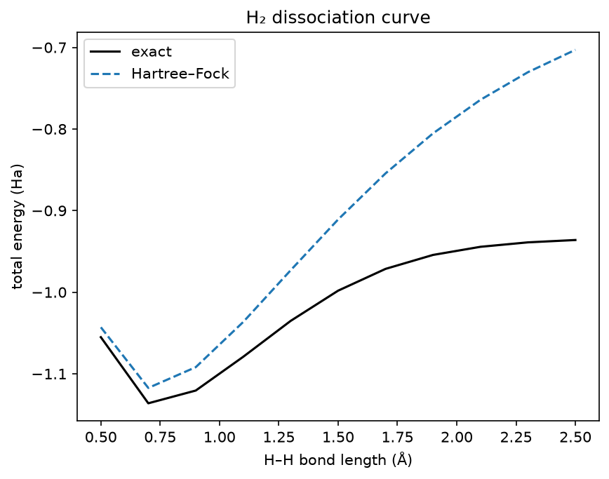

### 4.2 Why the 1-parameter circuit is exact for H₂ (symmetry, use #1)

After mapping, H₂ has 4 basis states. H₂ is mirror-symmetric, and single excitations break that symmetry, so they **never** enter the ground state. The ground state is always a mix of just two states (Hartree–Fock and the double excitation), and that two-state family is exactly what the 1-parameter circuit prepares. Numerically, the weight outside those two states is < 10⁻¹⁰ at every bond length.

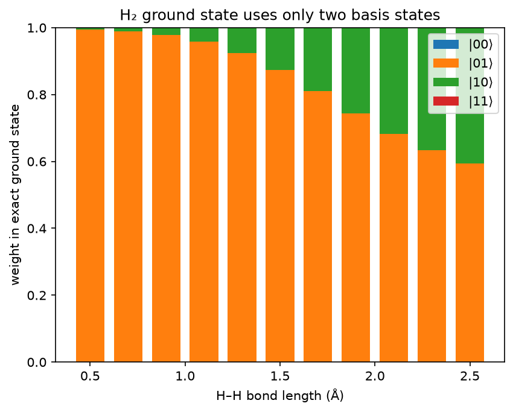

So the prototype is exact (< 10⁻⁶ mHa) everywhere. The general 12-parameter `efficient_su2` circuit is *worse* when stretched (up to ~0.4 mHa). **A circuit built from the chemistry beats a generic one here.**

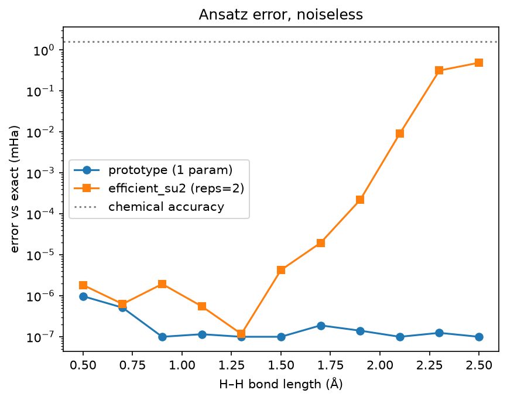

### 4.3 Predicting failure: HeH⁺ (symmetry, use #2)

HeH⁺ also has 2 electrons in 2 orbitals, but it has **no mirror symmetry**, so single excitations do mix in. The prediction was that the prototype would miss slightly, and it does: **0.16 mHa** at 0.60 Å, while the general circuit is exact (10⁻⁶ mHa). The error tracks the weight the prototype cannot reach. The gap is real but below chemical accuracy.

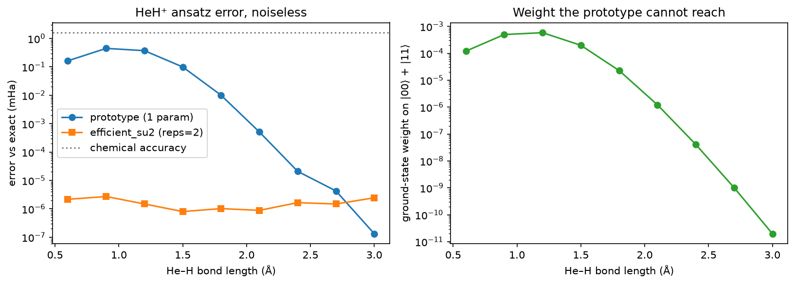

### 4.4 Optimizers: gradient-based vs gradient-free

Without noise, on the 8-parameter circuit, the gradient-based L-BFGS-B and SLSQP were most accurate (median error ~10⁻⁷ mHa). COBYLA reached 0.68 mHa and Nelder-Mead 1.9 mHa. SPSA with textbook, untuned settings did not converge in the budget. **Under shot noise**, finite-difference gradients break down. In a full noisy run COBYLA found an angle only **2.4 mHa** worse than ideal, while the untuned SPSA was still far off. That is a tuning limitation, not a verdict on SPSA.

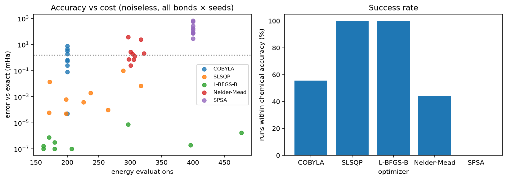

### 4.5 Warm start

Starting each bond length from the previous optimum, instead of from Hartree–Fock, saved **about 21–23%** of evaluations with the same accuracy. It only works with a small first step (`rhobeg=0.05`). With COBYLA's default 1-radian step, the saving was ~5%. (The exact percentage varies by a few evaluations between runs, from tiny floating-point differences.)

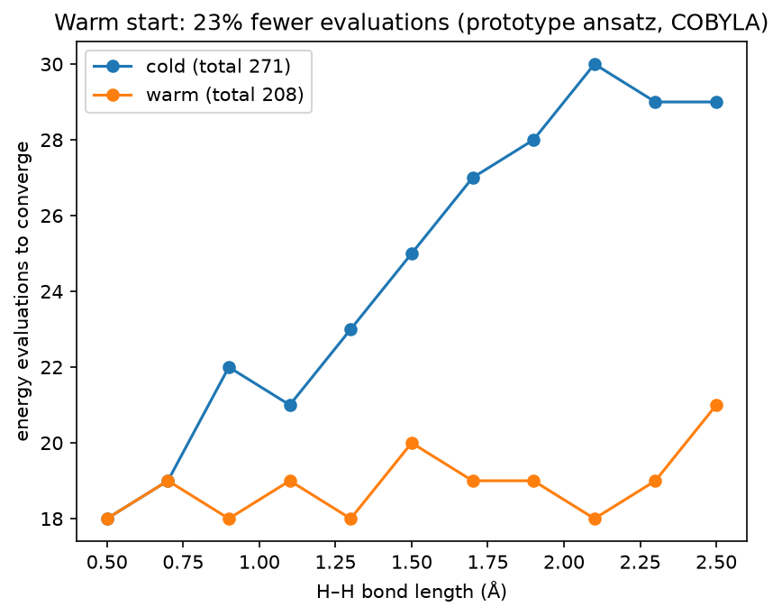

### 4.6 Noise, mitigation and the error budget

On a simulator built from a real IBM chip's calibration, the error at 0.735 Å jumps to **54.8 mHa**. Correcting readout errors brings it to **5.9 mHa**.

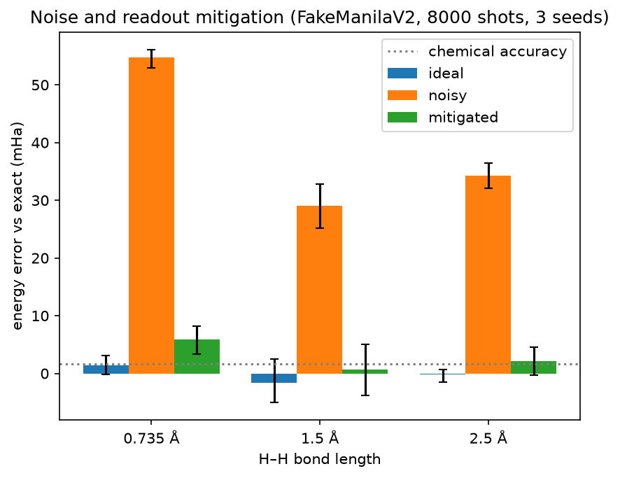

| Error source at 0.735 Å | mHa |
|---|---|
| ansatz | 0.00 |
| optimizer (noisy COBYLA) | 2.38 |
| shots | 1.34 |
| gate noise | 4.55 |
| **readout** | **48.85** |
| total raw → after mitigation | **57.13 → 8.28** |

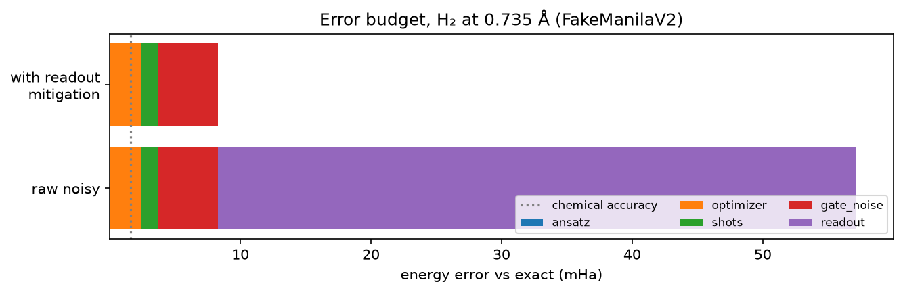

Readout causes ~86% of the raw error. The remainder is mostly gate noise. This is a first-order additive model, not an exact decomposition.

### 4.7 Symmetry as an error filter, and when it is wrong (symmetry, use #3)

Because H₂'s ground state never occupies |00⟩ or |11⟩, shots that land there are errors and can be discarded (**symmetry verification**, Bonet-Monroig et al. 2018). In simulation the gain was small and **within shot noise**: 5.9 → 4.3 mHa at 0.735 Å, with overlapping error bars.

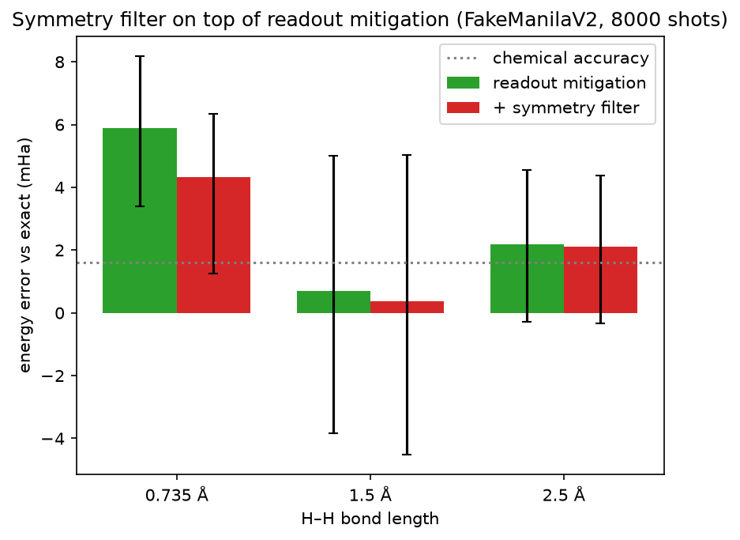

The same reasoning says the filter is **invalid for HeH⁺**. Applying it to HeH⁺'s *exact* ground state gives energies **below the true minimum** (down to −0.40 mHa). The variational principle from the VQE training says no valid state can do that, so the impossible answer flags the invalid filter.

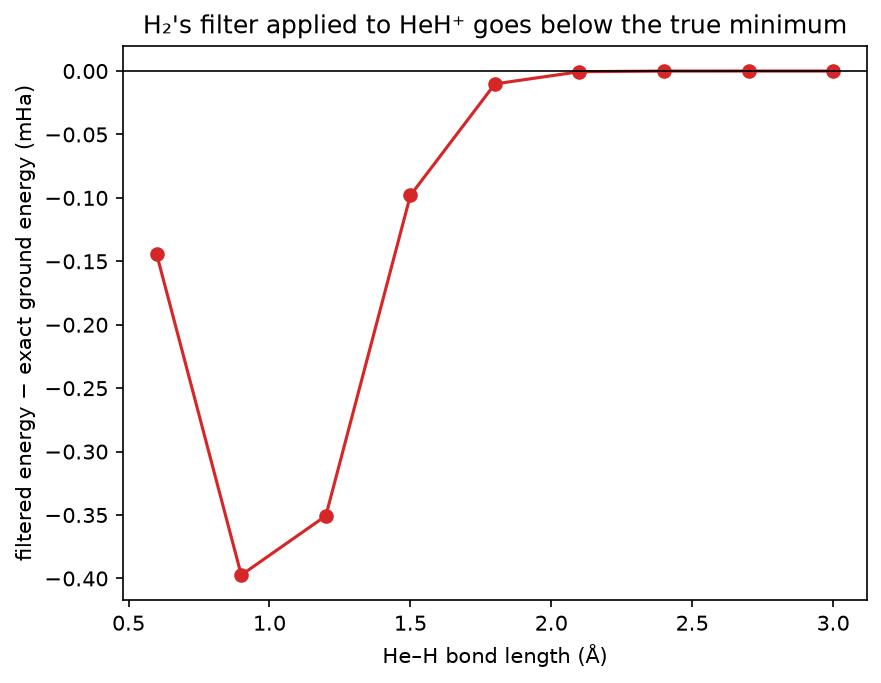

### 4.8 Real IBM quantum hardware

| Run | Backend | Job ID | Result |
|---|---|---|---|
| single point, 0.735 Å, IBM readout mitigation | ibm_marrakesh | dbdat51gv2cc738hoe60 | **7.01 mHa** |
| same, repeated | ibm_fez | dbdkfnk24mrc739ih5kg | 25.21 mHa |
| 8-point curve, qubits [0, 1] | ibm_marrakesh | not captured | readout-mitigated 0.9–17 mHa in size (2 points within chemical accuracy) |
| 8-point curve, qubits [0, 1] | ibm_kingston | dbe0bonsstms73fb8lfg | readout-mitigated 36–375 mHa (failed, see below) |
| single point, default qubits | ibm_fez | dbe0rtfpc3tc739kteq0 | 18.64 mHa |
| **8-point curve, best pair [148, 149]** | **ibm_kingston** | **dbe0scfgdj9s73fl0cm0** | **raw 1.8–20.6, readout-mitigated −2.3–12.3 mHa** |

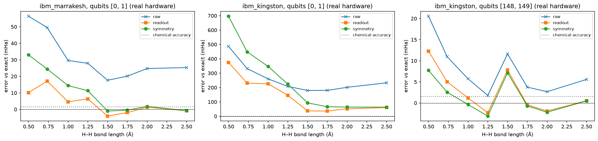

- **The noise model holds up:** real hardware gave 7.0 mHa against 5.9 mHa predicted by the mitigated simulator.
- **My own readout mitigation works on real hardware:** on ibm_marrakesh, raw errors of 18–56 mHa dropped to 1–17 mHa.
- **Results vary a lot between chips and qubits:** the same single-point job gave 7.0 mHa on ibm_marrakesh, and 25.2 and 18.6 mHa on ibm_fez.
- **The symmetry filter hurt on hardware** at short bond lengths (e.g. 4.6 → 14.4 mHa at 1.0 Å). That is far beyond shot noise, so it is a real effect.
- **Diagnosing the failure:** both curve runs landed on physical qubits [0, 1], because my code let the transpiler choose them. On ibm_kingston the readout calibration was far off (negative probability mass ≈ −0.7, against ≈ −0.005 in simulation), and IBM's calibration snapshot lists Kingston's qubit 1 at 16.8% readout error (median 0.95%). I fixed the code to choose the qubit pair with the lowest gate and readout error.
- **The fix works:** rerun on ibm_kingston's best pair [148, 149], raw errors fell from 180–486 mHa to **1.8–20.6 mHa**, 15–116× smaller on the same chip, depending on bond length. With readout mitigation, 3 of 8 bond lengths are within chemical accuracy (|error| < 1.6 mHa).
- **On good qubits the symmetry filter helped at short bond lengths** (12.3 → 7.7 mHa at 0.5 Å, 5.0 → 2.6 mHa at 0.735 Å) and was roughly neutral elsewhere. That fits the idea that its earlier failure came from bad qubits, but one run is not proof.

## 5. What improved over the prototype

| Question | Prototype | This project |
|---|---|---|
| Does it work beyond one geometry? | untested | exact from 0.5 to 2.5 Å, **with a symmetry explanation** |
| When does it fail? | unknown | **predicted and confirmed** (HeH⁺) |
| Cost of a full curve | cold start each point | **~21–23% fewer evaluations** (warm start) |
| On a noisy device | untested | 54.8 → 5.9 mHa with readout mitigation. Error budget identifies readout as ~86% |
| On real hardware | untested | **7.0 mHa** on ibm_marrakesh. Full curves. Choosing qubits by calibration cut raw errors 15–116× on ibm_kingston |

## 6. Limitations and honest negatives

- **No quantum advantage is claimed.** These molecules are tiny, and the exact answer is computed classically in milliseconds. The point is understanding how the algorithm and the hardware behave.
- The HeH⁺ effect is real but small (below chemical accuracy).
- The symmetry filter's benefit in simulation is within shot noise. On hardware it hurt on bad qubits and helped at short bond lengths on good ones. That comes from one run each, so it is not settled.
- SPSA was untuned. The error budget is approximate. The warm-start saving varies by about ±1%.
- Hardware results depend strongly on the chip and the qubits used on the day.

## 7. Next steps

LiH with a frozen core (4+ qubits, a real test of system size), tuned SPSA, zero-noise extrapolation for the remaining gate noise, and repeated hardware runs on calibration-selected qubits to settle the symmetry-filter question.

## 8. References

1. IQ Hackathon 2026 training materials (VQE notebook and slides), github.com/iq-hackathon/IQ-Hackathon-Fall-2026-Beginners
2. Peruzzo et al., *A variational eigenvalue solver on a photonic quantum processor*, Nature Communications 5, 4213 (2014).
3. Bonet-Monroig, Sagastizabal, Singh, O'Brien, *Low-cost error mitigation by symmetry verification*, arXiv:1807.10050 (2018).
4. Sagastizabal et al., *Experimental error mitigation via symmetry verification in a variational quantum eigensolver*, Phys. Rev. A 100, 010302 (2019).
5. Qiskit, Qiskit Nature, Qiskit IBM Runtime and PySCF documentation.

---
*Reproduce: open the Colab link above and choose Runtime → Run all. Hardware cells need an `IBM_QUANTUM_TOKEN` secret and otherwise skip. Figures in this report come from `scripts/make_figures.py`.*
